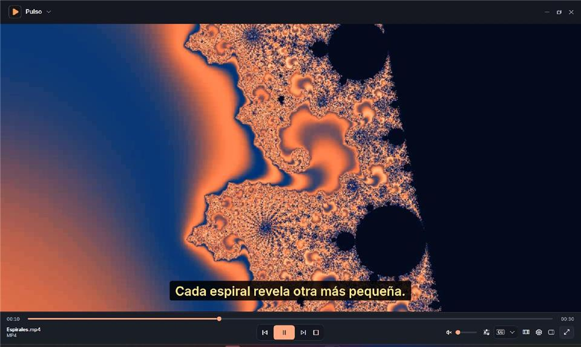
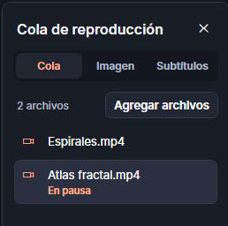
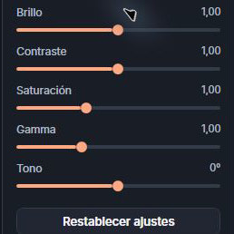

# Pulso

Reproductor de video y audio para Windows x64. Retoma cada película donde la dejaste, carga subtítulos SRT o genera subtítulos en inglés en tu propio equipo.

**[Descargar Pulso 0.4.32 beta para Windows x64](https://github.com/matfigueroac/pulso/releases/download/v0.4.32/Pulso-0.4.32-Setup-x64.exe)** · [Archivos, fuentes y SHA-256](https://github.com/matfigueroac/pulso/releases/tag/v0.4.32)

La instalación descarga los motores de video y audio. Después puedes reproducir y generar subtítulos sin internet. [Instalar sin conexión o compilar en Windows](docs/compilacion.md)

## Durante la reproducción

| Cola de reproducción | Ajustes de imagen |
| --- | --- |
| Agrega el siguiente video sin interrumpir el actual. El indicador de estado identifica el archivo activo. | Ajusta el brillo, el contraste y la saturación. Usa **Ver original** para comparar el resultado. |
|  |  |

[Guía de uso y atajos](docs/uso.md) · [Pruebas de reproducción 4K](docs/auditoria/README.md#rendimiento-4k) · [Licencia MIT](LICENSE) · [Avisos de terceros](THIRD-PARTY-NOTICES.md)
