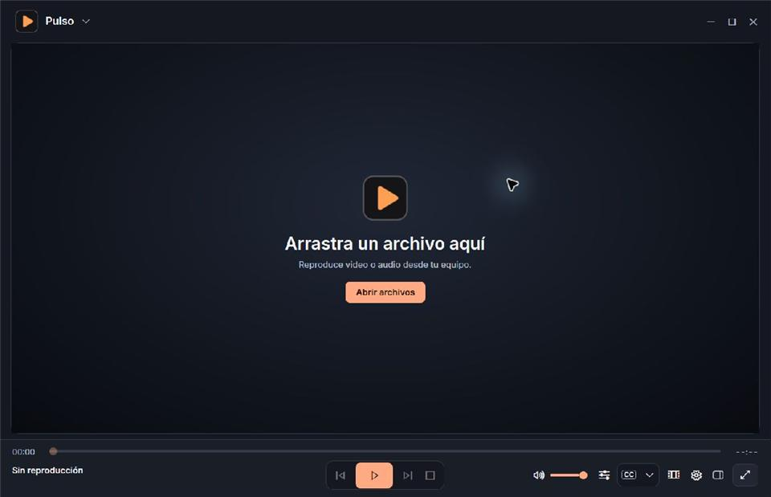
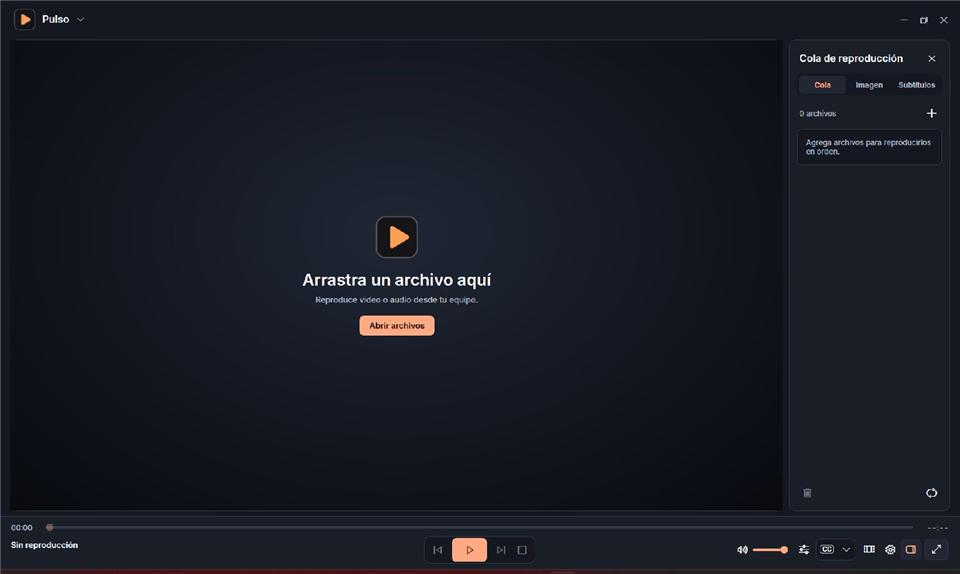
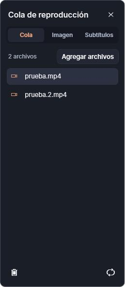
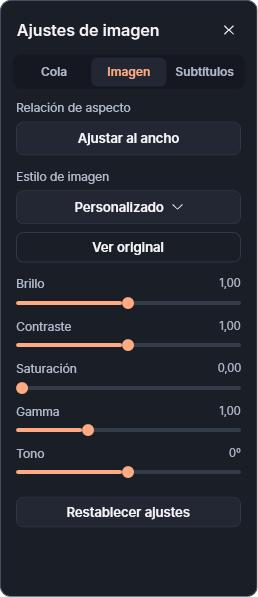
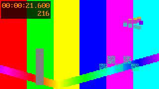

# Auditoría de Pulso para Windows

24 de noviembre de 2026 · Código local de la versión 0.4.31 · WPF y LibVLC

El inicio comunica bien cómo abrir un archivo. Los problemas de mayor impacto aparecían después, al trabajar con varios videos, volver a una película o manejar la barra con teclado. La revisión incluyó el código, la ventana en ejecución y pruebas con archivos multimedia generados para la auditoría.

## Recorrido y resultados

| Paso | Hallazgo | Resultado |
| --- | --- | --- |
| 1. Abrir Pulso | La zona de arrastre y el botón principal son visibles. En la cola, la acción distinta de agregar sin interrumpir estaba representada solo por un signo más. | La cola ahora muestra **Agregar archivos**, junto al contador. |
| 2. Abrir varios videos y SRT | Todos los subtítulos seleccionados juntos se asignaban al primer archivo. | Cada SRT con nombre coincidente acompaña a su video. Se probó con dos títulos que comparten prefijo y un sufijo de idioma. Un subtítulo elegido con otro nombre conserva la asociación manual al primer archivo. |
| 3. Pausar, buscar y quitar | Al quitar el último archivo activo se borraba la referencia antes de guardar el avance. Podía recuperarse una posición anterior. | Se guarda antes de retirar la referencia. Se verificó buscando más allá de los 19 segundos, quitando el video y abriéndolo de nuevo. Una pista elegida con el reproductor detenido también tiene prioridad al volver a reproducir. |
| 4. Comparar efectos | Al devolver los deslizadores a sus valores originales, el panel seguía indicando **Personalizado** y ofrecía comparar dos imágenes iguales. | El panel reconoce los valores de los estilos. Se probó saturación cero, vista original a color y regreso al blanco y negro mediante capturas de LibVLC. |
| 5. Usar pantalla completa | El temporizador podía ocultar la barra mientras un botón tenía el foco. Además, seguía consultando el cursor cada 33 ms en modo siempre visible. | La navegación con teclado mantiene visible la barra mientras el puntero está quieto. Se verificó el foco al vencer el plazo y la activación y detención del temporizador. El indicador de foco tiene dos bordes para distinguirse sobre botones oscuros y sobre el botón principal. |
| 6. Usar subtítulos | Las preferencias globales y por video duplicaban la lectura y escritura JSON. Los estilos leídos podían enviar valores fuera del intervalo válido al renderizador. | Ambos usan la misma escritura atómica y conservan sus ubicaciones y formato. Un archivo de prueba con tamaño cero, opacidad excesiva y borde negativo permitió abrir y reproducir el video. La prueba de voz generó dos subtítulos con sus tiempos a partir de dos frases en inglés. |

### Evidencia visual

1. Ventana de inicio antes de los cambios.

   

2. Cola anterior y detalle de la cola corregida con dos archivos.

   
   

3. Panel con saturación cero y dos fotogramas sucesivos de la prueba de comparación.

   
   
   

### Guardado del estilo de subtítulos

La vista previa se actualiza en cada cambio. En la prueba, 18 cambios consecutivos de tamaño produjeron una sola escritura. Después se eligió tamaño 37 y se cerró la ventana antes del guardado diferido. Un segundo proceso volvió a abrir el mismo video y mostró tamaño 37.

### Cola y reanudación

La cola elige el siguiente archivo y aplica la repetición. Cada carga tiene su propia solicitud. El seguimiento de posición descarta lecturas antiguas después de un salto y genera el marcador que se guarda al salir. Las pruebas de estas decisiones se ejecutan sin ventana ni motor multimedia.

### Anuncios de Narrador

Pulso anuncia los cambios de reproducción desde la ventana principal. Al elegir una pista comunica su nombre y al desactivarla identifica si corresponde a audio o subtítulos. Los errores tienen prioridad. El avance del contador y el progreso de generación de subtítulos quedan fuera de estos avisos.

En la salida de voz del Narrador de Windows se reconoció «Reproduciendo» con el nombre del archivo. La captura también incluyó voz de otras ventanas y solo permitió confirmar esa frase. Un cliente independiente de UI Automation recibió los diez avisos esperados al iniciar, pausar, reanudar, seleccionar audio y subtítulos, desactivar subtítulos, detener, abrir un MP4 dañado y reproducir hasta el final un WAV corto. El MP4 dañado produjo «No se pudo leer el archivo. Revisa su formato y ubicación.» y el WAV terminó con «Fin de la reproducción».

### Archivo activo en la cola

La fila activa muestra «Reproduciendo» o «En pausa» aunque se seleccione otro archivo. Windows UI Automation expone ese estado en el nombre accesible de la fila y entrega la selección por separado. Con dos archivos de audio se verificaron tanto el indicador visible como el nombre accesible al seleccionar otra fila, pausar, cambiar de archivo y detener.

### Carga de archivos

Soltar archivos sobre la cola conserva la reproducción en curso. Los subtítulos con nombres repetidos se asignan primero por carpeta. Si el nombre del subtítulo incluye la extensión del video, Pulso puede distinguir dos formatos del mismo título. Si falla la reproducción, se conserva el último marcador guardado.

## Mejoras que siguen abiertas

| Prioridad | Ámbito | Siguiente mejora y criterio de aceptación |
| --- | --- | --- |
| Baja | Accesibilidad | Completar la escucha de pausa, reanudación, detención, fin, pistas y error con Pulso en primer plano. |

## Alcance de la validación

Se compiló en Release para Windows x64 y se publicó un portable autocontenido. Se comparó el hash del ensamblado publicado con el utilizado en las pruebas. La reproducción y la búsqueda se comprobaron con LibVLC, los efectos mediante fotogramas y el foco mediante eventos WPF. Con voz sintética en inglés, el motor generó un SRT y los CC en vivo devolvieron texto reconocible con tiempos. Durante la prueba con la ventana oculta de la barra de tareas, LibVLC registró un aviso al configurar su miniatura. La reproducción y las capturas siguieron funcionando.

### Rendimiento 4K

En Windows, con un Ryzen 9 8940HX y una GeForce RTX 5060 Laptop, se probaron en ventana clips sintéticos de 3840 × 2160 a 60 fps en AVC de 8 bits y HEVC de 10 bits. Se usaron las estadísticas de fotogramas de LibVLC, el tiempo de CPU del proceso como porcentaje de la capacidad total del equipo y su memoria privada. La memoria de video queda fuera de esa cifra. El contador `VideoDecode` de Windows confirmó actividad de decodificación por GPU durante la sesión continua.

| Clip | CPU por software | CPU con hardware | Memoria privada por software | Memoria privada con hardware |
| --- | ---: | ---: | ---: | ---: |
| AVC | 5,3 % | 0,3 % | 837 MiB | 378 MiB |
| HEVC | 9,1 % | 0,4 % | 1.651 MiB | 496 MiB |

En esta comparación de ocho segundos por modo se midieron entre 58 y 60 fps y cero fotogramas perdidos. Los porcentajes de CPU variaron entre ejecuciones.

Durante seis minutos continuos de HEVC con aceleración, el video avanzó sin interrupciones. LibVLC registró cuatro fotogramas perdidos. La memoria privada estuvo entre 494 y 524 MiB, con 495 MiB al final, y la CPU entre 0,2 % y 0,4 %. Después de 12 cambios entre AVC y HEVC, los tramos muestreados siguieron alrededor de 60 fps y sin fotogramas perdidos. Los avisos de LibVLC durante las transiciones no impidieron abrir ningún clip.

La prueba de ajustes de imagen reprodujo un fotograma uniforme al cambiar la saturación con el decodificador por hardware. Pulso conserva el modo compatible como predeterminado. La opción de hardware se aplica al abrir el siguiente archivo y deshabilita los ajustes de color durante esa reproducción. El encuadre sigue disponible en ambos modos. Se verificó que el cambio mantiene el modo del archivo actual, y con capturas se confirmó color en ambos códecs con hardware y escala de grises en modo compatible.

#### Película completa en 4K

El 25 de noviembre de 2026, el portable Release reprodujo *Hook, Line and Sinker* de principio a fin en 1 h 14 min 42 s, en ventana y con audio silenciado. Se usó una edición reescalada y con fotogramas interpolados en AVC, 3840 × 2560 a 59,94 fps. LibVLC confirmó decodificación D3D11VA en la RTX 5060 Laptop y Pulso mostró «Fin de la reproducción». [Archivo de prueba en Internet Archive](https://archive.org/details/hook-line-sinker-4-k)

| Métrica | Resultado |
| --- | --- |
| Memoria privada del proceso | Mediana de 462 MiB entre los minutos 2 y 12, y de 473 MiB en los últimos 10 minutos. El pico de 683 MiB volvió a 470 MiB en la siguiente muestra, cinco segundos después. |
| Memoria 30 segundos después del fin | 188 MiB privados, frente a 95 MiB antes de abrir. La memoria dedicada en GPU pasó de 527 MiB justo antes del fin a 34 MiB después. |
| Fotogramas | LibVLC registró 268.485 mostrados y 28 perdidos. El archivo contiene 268.623 fotogramas, así que los contadores de LibVLC dejan otros 110 sin clasificar. Entre los minutos 2 y 12 y en los últimos 10 minutos mostró 59,94 fps, con cero pérdidas registradas. |

Veinticinco de los 28 fotogramas perdidos se registraron cerca del minuto 31:24, en el mismo intervalo que el pico de memoria privada. Poco antes, Windows registró 13 MiB de RAM disponible. Dos pasadas parciales cruzaron ese tramo sin pérdidas adicionales. Esta medición mostró un episodio breve, sin deterioro sostenido hasta el final. No se cambió el motor de reproducción con esta evidencia. La película completa se probó en este equipo con aceleración por hardware.

Quedan fuera de esta medición la precisión con diálogos de películas, varios monitores con DPI distintos y una instalación limpia en Windows 10.
